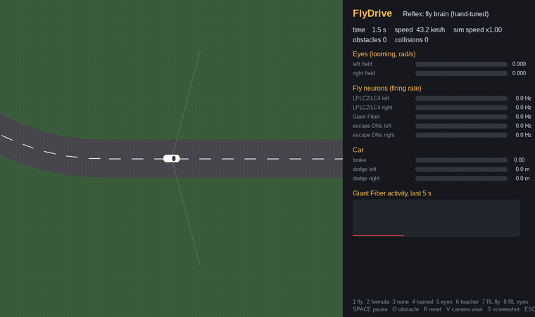

# FlyDrive 🪰🚗

**A driving simulator whose emergency reflexes run on the fruit fly's complete brain wiring
diagram**: the FlyWire connectome, ~139,000 neurons and 15 million connections, simulated as a
spiking network on an ordinary CPU.



A simple lane-follower keeps the car on the road but is blind to obstacles. When a box or a
pedestrian appears, the car's eyes measure **looming** (how fast its image grows) and drive the
fly's own looming-detector neurons (LPLC2 and LC4). The activity spreads through the whole
connectome to the fly's **escape neurons**, the Giant Fiber (DNp01) and other descending
neurons, and their firing becomes braking and a committed dodge, like a fly's escape jump.
Nothing about *which way to dodge* is hard-coded: at start-up the program stimulates the left
eye and discovers from the wiring which escape neurons respond.

## Highlights

- **It drives.** Trained by reinforcement learning from crashes alone, the fly-brain car avoids
  93% of 97 surprise obstacles at full speed, level with a "teacher" that sees every obstacle
  exactly ([results](#results)).
- **On camera pixels too.** With nothing but a 320x96 camera image it loses about one obstacle
  in 97 ([eyes only](#driving-on-camera-pixels)), and it also runs in a **Godot 4** 3D world.
- **Damage the brain and watch it fail.** Silencing 10 escape neurons makes the hand-tuned car
  hit 27 of 29 obstacles (6 intact). The learned car doesn't care: it found other routes
  through the connectome ([lesion experiment](#lesion-experiment-which-neurons-does-the-car-need)).
- **No single cell matters.** Silencing any one of the 50 most active interneurons removes under
  4% of the escape signal ([interneuron screen](#interneuron-screen-do-single-cells-matter)).
- **Honest numbers.** Every result comes with its control, its noise level, and the
  experiments that did *not* work.

| Normal world | Hard world (several obstacles, clutter) |
|---|---|
|  |  |

The panel shows the looming each eye sees, the policy's escape urge, and which of the fly's
descending neurons are firing.

## Quick start

Tested on Fedora 44 with Python 3.14; any Linux with Python 3.12+ should work. CPU only, no GPU.

```bash
git clone https://github.com/PradeepkrishnaGM/flydrive.git && cd flydrive
./setup_fedora.sh              # system packages (sudo), venv, connectome data (~135 MB), first check
source .venv/bin/activate
python run.py                  # a window opens: the fly brain is driving
```

Or step by step:

```bash
python3 -m venv .venv && source .venv/bin/activate
pip install -r requirements.txt        # numpy, scipy, pandas, pyarrow, pygame-ce
python download_data.py                # the fly's wiring diagram, from the FlyWire papers' repos
python run.py
```

The first run builds a connectome cache (15-60 s); after that it starts in seconds. Memory peaks
at about 1.5 GB during that build and stays under 500 MB while driving.

**Try next:**

```bash
python run.py --reflex rl                         # the fly brain trained by reinforcement learning
python run.py --eyes camera --reflex rl           # driving on camera pixels only (press V)
python run.py --difficulty hard --reflex rl       # the crowded world
python run.py --reflex fly --lesion esc_left,esc_right   # silence 8 escape neurons
python run.py --benchmark 120 --seeds 1,2,3,4,5   # the full comparison table, headless
```

**Keys:** `1` fly brain · `2` formula · `3` no reflex · `4` teacher-trained fly brain ·
`5` eyes-only · `6` teacher · `7` RL fly brain · `8` RL eyes-only · `V` camera view ·
`O` spawn an obstacle · `R` reset · `S` screenshot · `SPACE` pause · `ESC` quit

## How it works

```
camera or geometry ──> looming (rad/s, left / right eye)
                           │
                           ▼  Poisson spikes
        LPLC2 + LC4 looming neurons (314)
                           │
                           ▼  15 M synapses, leaky integrate-and-fire (Shiu et al. 2024)
        whole FlyWire brain, 139,000 neurons
                           │
                           ▼
        1,299 descending neurons (incl. Giant Fiber, escape DNs)
                           │
                           ▼  hand-tuned rule, teacher-trained readout, or RL policy
        brake + committed dodge (0.6 s, ballistic, like a fly's jump)
```

The connectome itself is never changed, just as a fly can't rewire its brain on the spot. What
varies is how the brain's output is read:

| Reflex | How it reads the brain |
|---|---|
| hand-tuned (`fly`) | Giant Fiber firing sets the braking, the escape DNs on each side set the dodge direction |
| teacher-trained (`trained`) | a linear readout over all 1,299 descending neurons, fitted to a teacher with DAgger |
| reinforcement learning (`rl`) | three linear heads (*escape now?*, *left or right?*, *brake?*), learned from crashes alone |

Each learned reflex has a brain-free **control** (`eyes`, `rl-eyes`) trained the same way on the
raw looming signal. If the fly brain beats its control, the connectome is doing useful work
rather than just passing the signal along.

### Learning from a teacher

A teacher that sees every obstacle's exact position labels the ideal action at every moment,
and a readout is fitted to those labels. With **DAgger** the car then drives with its own
readout, ends up in the situations its mistakes cause, and the teacher labels those too. Nobody
told the readout which neurons matter, yet the ones with the biggest say in dodge direction
were **DNp01 (the Giant Fiber), DNp02 and DNp04**, the classic escape neurons from the
literature, in two separate training runs.

### Learning from crashes

`train_rl.py` removes the teacher. The car is only told what happened after it acted: −1 for a
crash, −0.05 for launching an escape, −0.01 per metre lost to braking.

Trial-and-error RL normally needs thousands of drives, which would take days with a
139,000-neuron brain. Two facts make it unnecessary here:

1. **Until the car reacts, what the brain sees doesn't depend on the policy**, so each surprise
   obstacle and the brain's response to it is recorded once.
2. **An escape is ballistic**, a committed 0.6 s manoeuvre that runs without the brain.

So from every moment of every recorded encounter, the car practises all four escapes (left or
right, with or without braking) in a fast physics-only replay, about 94,000 practice escapes
in total. The replays reproduce the real drive to within 10⁻¹² m. Because every action at
every moment was practised, the policy gradient is computed exactly rather than estimated,
which makes learning fast and stable. One practice drive is held back to catch memorising.

Unlike the teacher-trained readout, the RL policy did **not** lean mainly on the Giant Fiber:
its "escape now" signal is dominated by DNb05 (pushing up) and DNg93 / DNg108 (pushing down).
With 255 active neurons and 161 practice encounters these weights are not unique, so treat the
exact neurons with caution.

## Results

`python run.py --benchmark 120 --seeds 1,2,3,4,5`: five obstacle layouts never used in training,
120 s each, 97 surprise obstacles.

| Reflex | Collisions per layout | Total | Avoided | Avg speed |
|---|---|---|---|---|
| no reflex | 15 17 17 15 18 | 82 | 15% | 43 km/h |
| fly brain, hand-tuned | 3 3 7 4 4 | 21 | 78% | 30 km/h |
| eyes only, teacher-trained (control) | 6 4 2 4 3 | 19 | 80% | 40 km/h |
| fly brain, teacher-trained | 3 1 3 3 2 | 12 | 88% | 42 km/h |
| hand-written formula | 2 1 1 5 1 | 10 | 90% | 39 km/h |
| eyes only, RL, all signals | 2 0 1 4 1 | 8 | 92% | 43 km/h |
| fly brain, RL, all signals | 3 0 2 3 0 | 8 | 92% | 43 km/h |
| eyes only, RL, squeezed to 8 | 2 0 1 4 0 | 7 | 93% | 43 km/h |
| **fly brain, RL, squeezed to 8** | **2 1 1 2 1** | **7** | **93%** | **43 km/h** |
| teacher (cheats: sees everything) | 1 3 1 1 1 | 7 | 93% | 42 km/h |

"Squeezed to 8" (`--components 8`) compresses the neuron signals into their 8 strongest
patterns before learning; the shipped RL models use it, and the full-signal ones are kept as
`models/rl_*_full.npz`.

- **Learning from crashes beat learning from the teacher** (12 → 8 → 7 collisions), matching a
  teacher that sees everything the car can't. Copying the teacher is partly impossible, because
  its decisions use information the car doesn't have; RL optimises what the car *can* do.
- **RL discovered that braking isn't worth it here.** Both RL policies swerve without braking,
  about 0.9 s after an obstacle appears; in the replays braking helped in only 115 of 23,400
  moments.
- **In this simple world the brain doesn't beat its control.** With the teacher it did (12 vs
  19), but with RL both reach 7. The eyes' looming signal already holds what this task needs;
  the brain only pulls ahead in the hard world.

With about 100 obstacles, differences of 1-2 collisions are noise. The numbers are
deterministic with the included models; retraining gives slightly different ones.

### The hard world: does the connectome earn its keep?

`--difficulty hard`: obstacles twice as often and up to three at once, people crossing twice as
fast (2.5-5 m/s), and harmless clutter 6-9 m off the road that looms but is never a threat. That
is 313 hazards over the five layouts. Both policies were retrained on hard-world practice.

| Reflex | Collisions per layout | Total | Avoided | Avg speed |
|---|---|---|---|---|
| no reflex | 35 32 30 30 31 | 158 | 50% | 43 km/h |
| fly brain, RL, all 282 neuron signals | 23 9 12 22 14 | 80 | 74% | 42 km/h |
| eyes only, RL, all 19 signals | 7 12 7 10 16 | 52 | 83% | 36 km/h |
| eyes only, RL, squeezed to 8 | 15 6 7 8 12 | 48 | 85% | 32 km/h |
| **fly brain, RL, squeezed to 8** | 7 10 7 9 10 | **43** | 86% | 34 km/h |
| hand-written formula | 9 5 5 7 11 | 37 | 88% | 30 km/h |
| teacher (cheats) | 7 6 5 5 12 | 35 | 89% | 39 km/h |

- **First, the fly brain did much worse** (80 vs 52). It read 282 neurons where the control read
  19, fitted the practice drives far better (32 crashes vs 98) and drove far worse: overfitting.
  It even failed to learn to brake, which pays in this world (braked on 66 of 248 escapes; the
  control on 231 of 238).
- **Compressing its signals fixed it**: 80 → 43 collisions, braking like the control, while the
  control improved only slightly (52 → 48). The failure was too little practice for too many
  knobs, not a limit of the connectome.
- Both learned policies still trail the formula (37) and the teacher (35): braking hard whenever
  anything looms is strong in a crowded world, and some collisions can't be avoided.

The trigger threshold is tuned on one practice layout, which is noisy: read gaps under about 8
collisions as noise. 80 vs 43 is far outside it; 43 vs 48 is not.

## Driving on camera pixels

With `--eyes camera` the car gets nothing but a 320x96 image from its bonnet. From each frame it:

1. **Sorts the pixels.** What road, grass and sky look like is learned from the first frame and
   keeps adapting; anything else is "in the way". No colour is hard-coded, so it also works on
   Godot's shaded picture (press `V` to see the classified image).
2. **Finds the road and steers**, using image rows that see the road 5-8 m ahead (flat ground,
   known camera height).
3. **Measures looming**: it tracks each "in the way" blob between frames and measures how fast
   its area grows.

| Check | Result |
|---|---|
| Road following, 2 laps, no obstacles | 3 cm average error, 17 cm worst |
| Pixel vs true looming, obstacle 6-12 m ahead | correlation 0.95 (which side: 0.94) |
| Pixel vs true looming, obstacle 12-40 m ahead | correlation 0.71, noticed in 68% of frames |
| Pixel classification vs the renderer's labels | no mistakes |

Same five layouts as above, policies trained on exact geometry and simply handed the camera's
version of the signal:

| Reflex | Exact geometry | Camera only | Avg speed (camera) |
|---|---|---|---|
| no reflex | 82 | 83 | 43 km/h |
| hand-written formula | 10 | 8 | 40 km/h |
| eyes only, RL | 8 | 11 | 43 km/h |
| **fly brain, RL** | **8** | **9** | **43 km/h** |
| teacher (cheats) | 7 | 5 | 42 km/h |

Losing the world's geometry costs the fly brain about one collision in 97.

### Optic-flow looming (`--looming flow`)

Real LPLC2 neurons respond to *motion* that expands outward, not to blob size. With
`--looming flow` the car measures optic flow instead: inside each tracked object it fits an
affine flow field between two frames (Lucas-Kanade, one window per object), whose divergence is
2 / time-to-contact. Sideways motion and static scenes give zero. The pixel classifier still
picks *where* to look.

| | Blob growth (default) | Optic flow |
|---|---|---|
| Correlation with true looming, 6-12 m | 0.94 (noticed 98%) | 0.90 (noticed 97%) |
| Correlation with true looming, 12-40 m | 0.53 (noticed 50%) | 0.52 (noticed 52%) |
| Hard world, fly brain RL: collisions of 94 | 11 | 14 |
| Hard world, eyes-only RL: collisions of 94 | 17 | 18 |
| Normal world, both RL policies: collisions of 29 | 0 | 0 |

(Correlations from `python experiments/eval_looming.py --seeds 1,2,3 --seconds 60`; collisions from 3 layouts
x 60 s.) Flow is about as good as blob growth, slightly behind in the hard world but within noise.

**Retraining on camera pixels did not help.** `python train_rl.py --camera --looming flow`
practises through the camera (8 drives per world, about 25 minutes on 6 cores) and saves
`models/rl_*_cam_flow.npz`; load them with `run.py --eyes camera --looming flow --rl-cam`. In the
hard world the camera-trained fly brain hit 19 of 94 obstacles (geometry-trained: 14) and the
eyes-only one 19 (18); both drove about 25% faster (42.4 / 39.7 vs 33.1 / 32.6 km/h), because
they brake and swerve less. That is a different speed/safety trade-off, not a safer car. The
normal world stayed at 0 for all.

## Lesion experiment: which neurons does the car need?

Because the reflexes run on the real connectome, we can damage it and see what breaks.
`--lesion` silences neurons so they never spike:

```bash
python run.py --reflex fly --lesion gf_left,gf_right     # the Giant Fiber
python run.py --reflex rl  --lesion LC4@left             # one cell type, one side
python run.py --reflex fly --lesion random:10:1          # 10 random neurons (a control)
python experiments/run_lesions.py                                    # the whole experiment (~30 min, 6 cores)
```

Each lesion drives the same 3 layouts for 60 s (29 obstacles). The reflex is built on the intact
brain and then lesioned, so it can't re-learn its wiring. Controls silence random neurons (10
and 162, five draws each) that are never in the looming or escape groups.


| Lesion | Hand-tuned fly brain | Learned (RL) fly brain |
|---|---|---|
| none | 6/29 collisions | 0/29 |
| Giant Fiber (2 neurons) | **0/29** | 1/29 |
| other escape DNs (8) | **21/29** | 0/29 |
| all escape outputs (10) | **27/29** | 0/29 |
| LPLC2 looming neurons | 4/29 | **9/29** |
| LC4 looming neurons | 7/29 | **5/29** |
| left eye's looming neurons (162) | 11/29 | **9/29** |
| random 10 / random 162 (5 draws each) | 6.0 / 6.2 | 0 / 0 |

- **The hand-tuned car depends on the 8 escape DNs, not the Giant Fiber.** That is where its
  dodge direction comes from. Silencing the Giant Fiber, which drives its braking, made it crash
  *less* (0 vs 6) at full speed; why is untested (one guess: braking keeps the car near crossing
  obstacles longer).
- **The learned car does not need the escape neurons at all.** It reads all 1,299 descending
  neurons and still avoids everything with the 10 escape neurons silenced. What it needs is the
  signal from the eyes: silencing either looming cell type, or one eye, makes it crash. The
  policy found routes through the connectome outside the textbook escape circuit.
- **The two looming cell types feed different pathways.** With the left eye driven at 60 Hz,
  silencing LPLC2 cuts the Giant Fiber from 77 to 33 spikes but leaves the escape DNs alone (117
  → 116); silencing LC4 does the opposite (escape DNs 117 → 37, Giant Fiber 77 → 68).
- **The effects are specific**: random lesions change nothing.

Only the large effects (27, 21, 9 collisions against 0-6) should be trusted; differences of 1-3
are noise. Data: `results/lesion_results.csv`.

## Interneuron screen: do single cells matter?

`python experiments/run_screen.py` (about 15 minutes) goes one level down. It takes the 50 most active
neurons between the eyes and the escape neurons, silences each alone, and measures how many
spikes the escape outputs (Giant Fiber + 8 escape DNs) and the whole descending population lose.


| Silenced | Escape outputs lose | Descending population loses |
|---|---|---|
| best single neuron (PVLP069_left) | 3.6% | 6.2% |
| top 5 together | 14% | 24% |
| top 10 together | 25% | 32% |
| top 20 together | 35% | 39% |

- **No single interneuron is a bottleneck.** The strongest removes under 4% of the escape output,
  barely above the noise (baseline replicates differ by about ±1.5%, the grey band). The signal
  is spread over many cells (PVLP069, PVLP151, PVLP122b, AVLP016, AVLP396), and their effects add.
- **Losing a quarter of the escape signal doesn't hurt the car.** With the top 10 silenced, the
  hand-tuned car hit 4 of 29 obstacles and the RL car 1, against 6 and 0 intact, and 7-8 and 0-1
  for random sets of the same size (3 draws). The car needs *some* escape signal, not all of it.

Cumulative lesions are re-measured on fresh noise seeds, so lucky rankings don't inflate them.
Data: `results/screen_results.csv`, `results/screen_behaviour.csv`.

## Reference

### Commands

| Command | What it does |
|---|---|
| `python run.py --reflex KIND` | Drive with `fly`, `trained`, `rl`, `eyes`, `rl-eyes`, `direct` (formula), `teacher` or `none` |
| `python run.py --benchmark 120 --seeds 1,2,3,4,5` | Headless comparison of every reflex (`--only rl,fly` to pick) |
| `python run.py --difficulty hard` | The crowded world |
| `python run.py --eyes camera [--looming flow]` | Drive on camera pixels (blob growth or optic flow) |
| `python run.py --eyes camera --renderer godot` | ...seeing through the Godot 3D world |
| `python run.py --eyes camera --looming flow --rl-cam` | Use the camera-trained RL policies |
| `python run.py --lesion SPEC` | Silence neurons: group names, cell types (`LC4@left`), `random:N:SEED`, `ids:1;2;3` |
| `python run.py --probe` | Print how the escape neurons respond to looming on each side |
| `python run.py --brain-dt 1.0` | Coarser neuron time step, about 2x faster |
| `python train_rl.py [--difficulty hard] [--components 8]` | Reinforcement learning (10-35 min; models ship with the repo) |
| `python train_rl.py --camera --looming flow` | RL practice through the camera |
| `python train.py` | Teacher-trained (DAgger) readouts, about 10-15 min |
| `python experiments/eval_looming.py` | Pixel looming (blob vs flow) against the true looming |
| `python experiments/run_lesions.py` / `python experiments/run_screen.py` | The lesion experiment / the interneuron screen |
| `python experiments/make_showcase.py find` / `build` | Rebuild the demo GIF, social images and comparison video |
| `python -m pytest -m "not slow"` | Quick tests; drop `-m "not slow"` to include the brain tests (need `data/`) |

Training records practice drives in `models/rl_data/` (git-ignored), so re-running only retrains
the policy, in seconds. `--jobs N` records N drives at once (about 0.6 GB each).

### The Godot 3D world

`godot_world/` is a Godot 4 project that acts as the car's eyes: Python sends it the car and
obstacles, Godot renders the camera view and sends the pixels back (length-prefixed JSON / RGB
over TCP). The world's rules stay in Python, so results are comparable with every other mode.

```bash
sudo dnf install -y godot
python run.py --eyes camera --renderer godot --reflex rl   # starts Godot for you
```

Or open `godot_world/` in the editor, press **Play**, and add `--no-launch`. Tested with Godot
4.7.2 on Fedora 44 (headless under Xvfb): it connects, renders, and the car drives on its pixels.
See `godot_world/README.md`.

### Troubleshooting

| Problem | Fix |
|---|---|
| `pip install` fails building a wheel | Use a Python with ready-made wheels, e.g. `sudo dnf install python3.13` and `python3.13 -m venv .venv` |
| The window doesn't open (Wayland) | `SDL_VIDEODRIVER=x11 python run.py`, or use `--benchmark`, which needs no display |
| `download_data.py` fails | Retry; it skips files already fetched |
| Godot never connects | Check `godot_world/godot.log` and `godot --version` (4.x), or press Play and add `--no-launch` |
| It feels slow | The brain is the cost: `--brain-dt 1.0`, or `--reflex rl-eyes`, which needs no brain |

The simulation is locked to simulated time, so results don't depend on the CPU; on a slow one
the window just runs in slow motion ("sim speed" in the panel). On an i5-10500T, a 60 s fly-brain
drive takes about 100 s of CPU time per core.

### Project layout

```
flydrive/
  connectome.py   loads FlyWire v783, finds LPLC2/LC4, the Giant Fiber and escape DNs by cell type
  brain.py        whole-brain leaky integrate-and-fire model, event-driven NumPy; lesions
  lesion.py       turns a lesion spec into neuron indices
  world.py        road, car physics, obstacles, "normal" and "hard" worlds
  camera.py       the car's camera and a small 3D renderer (also feeds Godot)
  vision.py       driving from pixels: classify, find the road, blob or optic-flow looming
  controller.py   lane follower, reflexes (none / formula / fly), ballistic dodge
  readout.py      teacher, feature extractors, teacher-trained readout
  rl.py           practice recording, exact escape replays, policy-gradient training
  render.py       pygame window with live neuron activity
  godot_bridge.py talks to the Godot world over TCP
experiments/
  eval_looming.py   pixel looming (blob vs optic flow) against the true looming
  run_lesions.py    the lesion experiment (plot_lesions.py draws its chart)
  run_screen.py     the interneuron screen
  make_showcase.py  the demo GIF, social images and comparison video
run.py            drive, benchmark, probe (the main entry point)
train.py          teacher-trained (DAgger) readouts
train_rl.py       reinforcement learning
download_data.py  fetches the FlyWire data;  setup_fedora.sh does everything on Fedora
tests/            pytest (optic flow, lesions); brain tests are marked slow
godot_world/      the Godot 4 project
models/           trained readouts and RL policies
docs/             README images and GIF
results/          experiment results (CSV)
```

Design decisions and their reasons are logged in `DECISIONS.md`.

## Limitations

The neuron model is simplified (all neurons identical, no plasticity, no neuromodulation), so
this approximates the fly's wiring rather than emulating a real fly. The sensory input skips the
fly's retina and optic lobe, the readouts are linear, and most benchmarks use 29-313 obstacles,
so small differences are noise. It is an experiment in brain-inspired control, not a safety
system; never use anything like it on a real vehicle.

## Ideas to extend it

- **Mask-free optic flow:** subtract the expected ground flow (flat road, known camera height)
  instead of using the pixel classifier to pick regions.
- **On-policy practice:** let the RL policy drive, record the situations its own escapes lead
  to, and retrain.
- **Nonlinear policy:** a small two-layer network instead of the linear heads.
- **More practice for the camera policy**, or a reward that values speed explicitly.
- **More senses:** wind or touch neurons for side collisions, light-sensitive neurons for tunnels.
- **Compare flies:** swap in the male fly connectome (MaleCNS) and see whether its reflexes differ.

## Credits and license

- Connectome: Dorkenwald et al. 2024, *Neuronal wiring diagram of an adult brain*, Nature.
- Cell types: Schlegel et al. 2024, *Whole-brain annotation and multi-connectome cell typing*,
  Nature.
- Neuron model and connectivity files: Shiu et al. 2024, *A Drosophila computational brain model
  reveals sensorimotor processing*, Nature
  ([github.com/philshiu/Drosophila_brain_model](https://github.com/philshiu/Drosophila_brain_model)).

Please cite these papers if you share results. The code is MIT-licensed (see `LICENSE`). The
connectome data is not included; `download_data.py` fetches it from the papers' public
repositories, under their own terms.
