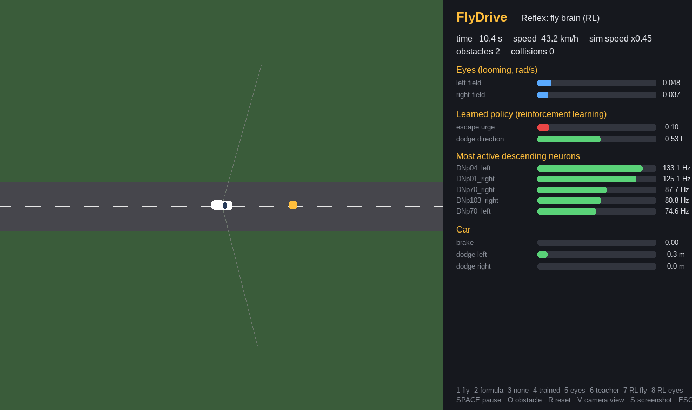
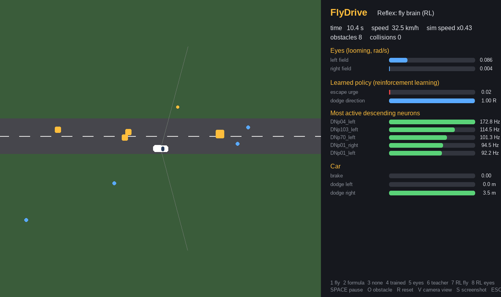
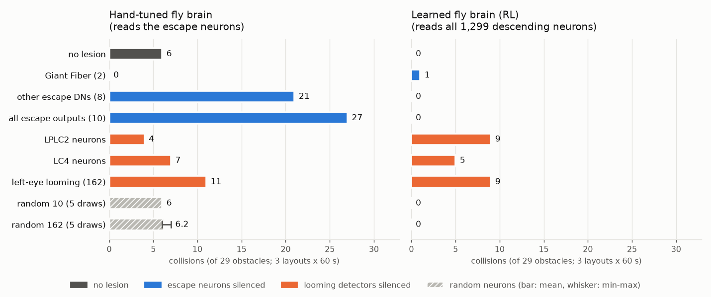
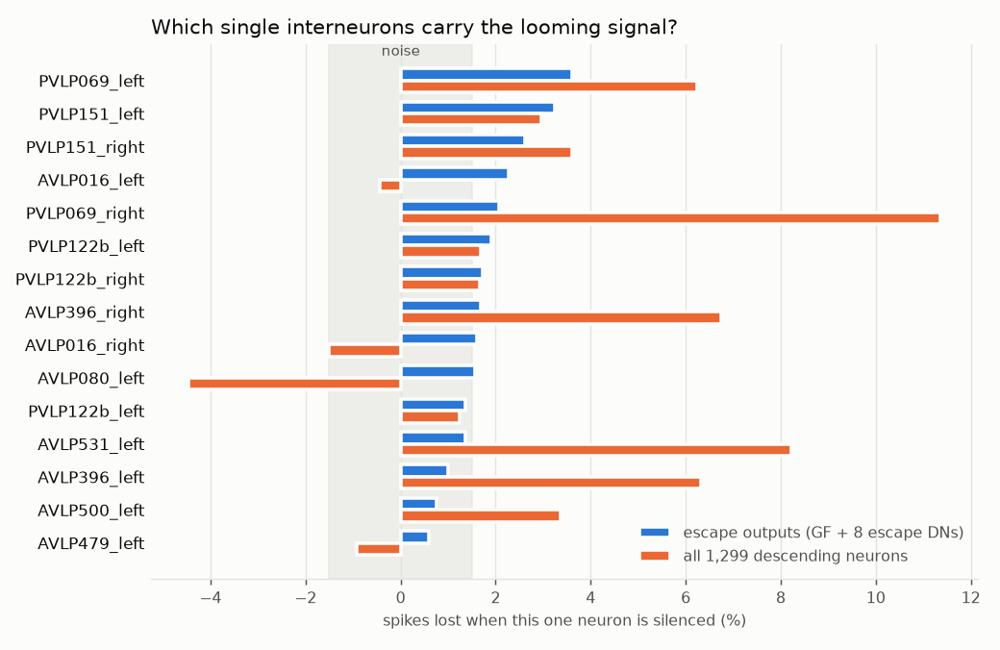

# FlyDrive 🪰🚗

A 2D driving simulator where the car's **emergency reflexes come from the real fruit fly brain**.

A simple lane-following "driver" keeps the car on the road but is blind to obstacles. Boxes and
pedestrians appear suddenly ahead. The car's "eyes" measure **looming** (how fast an object's
image grows) and feed it into the fly's own looming-detector neurons (LPLC2 and LC4). Activity
then spreads through the **full FlyWire connectome, all ~139,000 neurons and 15 million
connections**, to the fly's escape neurons: the **Giant Fiber** (DNp01) and other escape
descending neurons. Their firing is turned into braking and a committed dodge, like a fly's
escape jump.

Nothing about *which side to dodge* is hard-coded: at startup the program stimulates the left
eye's looming neurons and discovers from the wiring which escape neurons respond.

**v2: you can train it.** `train.py` teaches the fly brain to drive by learning a small
readout layer on top of all 1,299 of the fly's descending neurons (see
[Teaching the fly brain](#teaching-the-fly-brain) below).

**v3: it learns from crashes alone.** `train_rl.py` uses reinforcement learning. There's
no teacher; the car is only told whether each practice escape crashed (see
[Learning from crashes](#learning-from-crashes-reinforcement-learning)).

**New in v4: it can drive on camera pixels**, with no access to the world's geometry, in
FlyDrive's own 3D renderer or in a **Godot 4** world (see
[Driving with eyes only](#driving-with-eyes-only)). There's also a **hard world** with faster
obstacles, several at once and roadside clutter (`--difficulty hard`), where the fly brain
first fails badly and then, with its signals compressed, comes out slightly ahead of plain
eyes: see [The hard world](#the-hard-world-does-the-connectome-earn-its-keep).

| Normal world | Hard world (several obstacles, clutter) |
|---|---|
|  |  |

The bars on the right show the looming each eye sees, the learned policy's escape urge, and
which of the fly's descending neurons are firing.

## Running it on Fedora 44

Everything below is copy-paste. The one-liner:

```bash
unzip flydrive_v7.zip && cd flydrive
./setup_fedora.sh              # packages, virtual environment, data (~135 MB), first check
source .venv/bin/activate
python run.py                  # the window opens: the fly brain is driving
```

### Step by step

```bash
# 1. system packages (Python, compiler for building wheels, unzip)
sudo dnf install -y python3 python3-pip python3-devel gcc unzip

# 2. the project, in its own virtual environment
unzip flydrive_v7.zip && cd flydrive
python3 -m venv .venv
source .venv/bin/activate
pip install --upgrade pip
pip install -r requirements.txt        # numpy, scipy, pandas, pyarrow, pygame-ce

# 3. the fly's wiring diagram (~135 MB, from the FlyWire papers' public repos)
python download_data.py

# 4. drive
python run.py                          # window: hand-tuned fly brain
```

The first run builds a cache of the connectome (15-60 s). After that it starts in a few
seconds. Peak memory is about 1.5 GB during that first build and under 500 MB while driving,
so 16 GB is plenty. Everything runs on the CPU; no GPU needed.

### What to try first

```bash
python run.py --reflex rl                        # the reinforcement-learning fly brain
python run.py --eyes camera --reflex rl          # ...driving on camera pixels only (press V)
python run.py --difficulty hard --reflex rl-eyes # the crowded world
python run.py --benchmark 120 --seeds 1,2,3,4,5  # the full comparison table (headless)
```

In the window: `1`-`8` switch reflex, `V` shows what the camera sees, `O` throws an obstacle in
front of you, `R` resets, `S` saves a screenshot, `SPACE` pauses.

### Adding the Godot 3D world (optional)

```bash
sudo dnf install -y godot                        # Godot 4
godot --version                                  # expect 4.x
python run.py --eyes camera --renderer godot --reflex rl
```

Flatpak instead of the dnf package:

```bash
flatpak install -y flathub org.godotengine.Godot
python run.py --eyes camera --renderer godot --reflex rl \
  --godot "flatpak run org.godotengine.Godot"
```

Or open `godot_world/` in the Godot editor, press **Play**, and start Python with
`--no-launch`. Godot's own output goes to `godot_world/godot.log`.

### Training it yourself (optional)

```bash
python train_rl.py --jobs 4                      # reinforcement learning, ~10-25 min
python train_rl.py --difficulty hard --jobs 4    # the hard world, ~35 min
python train.py                                  # the older teacher-taught version, ~10-15 min
```

`--jobs N` records N practice drives at once (about 0.6 GB memory each). Recorded drives are
kept in `models/rl_data/`, so re-running only retrains the policy, in seconds. Trained models
ship with the project, so you can skip all of this.

### If something goes wrong

| Problem | Fix |
|---|---|
| `pip install` fails building a wheel | Fedora 44's Python may be newer than some wheels: `sudo dnf install -y python3.13` then `python3.13 -m venv .venv` and repeat |
| The window doesn't open (Wayland) | `SDL_VIDEODRIVER=x11 python run.py`, or use `--benchmark`, which needs no display |
| `download_data.py` fails | Check the network, then retry; it resumes by skipping files already fetched |
| Godot never connects | Check `godot_world/godot.log`, confirm `godot --version` is 4.x, or press Play in the editor and add `--no-launch` |
| It feels slow | The brain is the cost: `--brain-dt 1.0` roughly doubles speed, and `--reflex rl-eyes` needs no brain at all |

## Commands

| Command | What it does |
|---|---|
| `python run.py` | Watch the fly-brain car drive |
| `python run.py --reflex rl` | The fly brain trained by reinforcement learning |
| `python run.py --reflex rl-eyes` | Reinforcement learning on the raw looming signal, no brain (control) |
| `python run.py --reflex trained` | The fly brain with its readout trained by a teacher |
| `python run.py --reflex none` | Car with no reflex, for comparison |
| `python run.py --reflex direct` | Hand-written looming formula, no neurons |
| `python run.py --reflex eyes` | Trained readout on the raw looming signal, no brain (control) |
| `python run.py --reflex teacher` | The "cheating" teacher that sees every obstacle exactly |
| `python run.py --benchmark 120` | Headless test: 120 s of driving for each reflex type |
| `python run.py --benchmark 120 --seeds 1,2,3,4,5` | Same, averaged over 5 obstacle layouts |
| `python run.py --benchmark 120 --only trained,fly` | Benchmark just the reflexes you name |
| `python train.py` | Train the readouts with a teacher (about 10–15 min on a laptop) |
| `python train_rl.py` | Train by reinforcement learning (about 10–25 min, see below) |
| `python train_rl.py --difficulty hard --components 8` | Train for the hard world (about 35 min) |
| `python run.py --eyes camera` | Drive on camera pixels only, with the built-in 3D renderer |
| `python run.py --eyes camera --renderer godot` | ...seeing through the Godot 3D world |
| `python run.py --difficulty hard` | The harder world (faster, more crowded, with clutter) |
| `python run.py --probe` | Print how the fly's escape neurons respond to looming |
| `python run.py --brain-dt 1.0` | Coarser neuron time step: roughly 2× faster, a bit less accurate |
| `python run.py --loom-gain 900` | Make the fly's eyes more sensitive (default 600) |

**Keys in the window:** `1` fly brain · `2` formula · `3` no reflex · `4` trained fly brain ·
`5` eyes-only · `6` teacher · `7` RL fly brain · `8` RL eyes-only · `SPACE` pause ·
`O` spawn an obstacle · `R` reset · `V` what the camera sees · `S` screenshot · `ESC` quit

## Driving with eyes only

By default the car is handed the exact geometry of every obstacle. With `--eyes camera` it
gets nothing but a camera image, 320x96 pixels from the bonnet, and has to work out both where
the road is and what's coming, the way a person does.

From each frame it:

1. **Sorts the pixels.** What road, grass and sky look like is measured from the first frame
   and keeps adapting, so it survives different lighting. Anything that matches none of them
   is "something in the way". No colour is hard-coded, so it also works on Godot's shaded,
   shadowed picture.
2. **Finds the road and steers.** A few image rows correspond to the road 5-8 m ahead (flat
   ground, known camera height, the same cue people use). It finds the road's edges in those
   rows and aims for the middle, plus whatever sideways dodge the reflex asks for. If one edge
   is out of view it uses the other one and the known road width.
3. **Measures looming.** It groups the "in the way" pixels into blobs, follows each blob
   between frames, and measures how fast it grows, using the blob's whole area so the estimate
   is steadier than its width alone. That growth is the looming signal the fly brain eats.

Press `V` in the window to see the classified image instead of the raw one.

### Does it work?

| Check | Result |
|---|---|
| Road following, 2 laps with no obstacles | 3 cm average error from the centreline, 17 cm worst |
| Pixel looming vs true looming, obstacle 6-12 m ahead | correlation 0.95 (which side: 0.94) |
| Pixel looming vs true looming, obstacle 12-40 m ahead | correlation 0.71, noticed in 68% of frames |
| Pixel classification against the renderer's own labels | no mistakes |

Far-away obstacles are only a few pixels wide, so looming is noisy there, which is exactly the
limitation a real camera has.

### Looming from optic flow (`--looming flow`)

The default measures how fast a blob's area grows. With `--looming flow` the car instead
measures **optic flow**, the way LPLC2 neurons do: how the image's brightness pattern moves
between two frames. Inside each tracked object's region the flow is fitted as an affine field
(Lucas-Kanade, one window per object); its divergence is twice the expansion rate, i.e. 2 / time
to contact. Sideways motion and static scenes give zero. The pixel classifier still decides
*where* to look, then flow decides *how fast it is growing*. The output has the same units as
the blob method, so the trained models work unchanged. Its tunable numbers are at the top of
`flydrive/vision.py` (`FLOW_*`).

Measured with `python eval_looming.py --seeds 1,2,3 --seconds 60` (no reflex, so every obstacle
is approached all the way):

| Obstacle distance | Blob growth: correlation / noticed | Optic flow: correlation / noticed |
|---|---|---|
| 6-12 m | 0.94 / 98% | 0.90 / 97% |
| 12-40 m | 0.53 / 50% | 0.52 / 52% |

So optic flow is about as good as blob growth: slightly noisier up close, equal far away.

Driving results with the RL policies (`--eyes camera --benchmark 60 --seeds 1,2,3`, collisions
out of all obstacles over the 3 layouts):

| World | Reflex | Blob growth | Optic flow |
|---|---|---|---|
| Normal (29 obstacles) | fly brain, RL | 0 | 0 |
| Normal (29 obstacles) | eyes only, RL | 0 | 0 |
| Hard (94 obstacles) | fly brain, RL | 11 (88% avoided) | 14 (85%) |
| Hard (94 obstacles) | eyes only, RL | 17 (82%) | 18 (81%) |

Flow is on par in the normal world and a little behind in the hard one. The policies were
trained on geometric looming, so neither pixel method is a perfect match, and with one run of
three layouts the hard-world gap is within noise.

## The Godot 3D world

`godot_world/` is a Godot 4 project that acts as the car's eyes: Python sends it the car and
obstacles, it renders the view from the car's camera and sends the pixels back, and shows you
a chase camera with the car's own view inset.

```bash
sudo dnf install godot                                    # Fedora
python run.py --eyes camera --renderer godot --reflex rl  # starts Godot for you
```

Or press Play in the Godot editor yourself and add `--no-launch`. The world's rules stay in
Python, so results are comparable with every other mode, and the vision code is identical:
only the pictures change. See `godot_world/README.md`.

**Tested how far:** the GDScript is syntax-checked and lint-clean, and the protocol was tested
against a stand-in client, but the project has not been run inside Godot itself, because Godot
could not be installed on the machine that wrote it. Everything else works without Godot.

## Teaching the fly brain

The connectome itself is never changed, just as a real fly can't rewire its brain on the spot.
Instead, a small **readout** layer learns which of the fly's 1,299 descending neurons (the
brain's output cables to the body) signal danger and which way to dodge. This is called
*reservoir computing*: a large fixed network transforms the input, and only the last layer is
trained.

Training is imitation learning with **DAgger**:

1. A **teacher** that can see every obstacle's exact position and speed decides the ideal
   action at every moment.
2. The car drives while the teacher labels each moment; the readout is fitted to those labels.
3. The car drives again **using the trained readout**, so it ends up in the awkward situations
   its own mistakes cause. The teacher labels those too, and the readout is refitted.

The fly never sees what the teacher sees. It only gets the looming signal through its own
LPLC2/LC4 neurons, and has to work out the rest from how the connectome responds.

```bash
python train.py                  # trains the eyes-only control, then the fly brain
python train.py --kind fly       # just the fly brain
python train.py --resume         # continue if training was interrupted
python train.py --iters 5 --seconds 120   # train longer
```

Pre-trained readouts are included in `models/`, so `python run.py --reflex trained` works
straight away. Training again overwrites them.

A fair **control** is trained the same way: the "eyes-only" readout sees the same looming
signal (plus its recent history) with no brain in between. If the fly brain beats it, the
connectome is doing useful work, not just passing the signal along.

### What the readout discovered

Nobody told the readout which neurons matter. After training, the neurons with the biggest
say in dodge direction were **DNp01 (the Giant Fiber), DNp02 and DNp04**, the classic escape
neurons that version 1 picked by hand from the scientific literature. The readout
rediscovered them from 1,299 candidates in two separate training runs.

`train.py` prints the top neurons at the end of each run, so you can check this yourself.

## Learning from crashes (reinforcement learning)

The teacher above cheats: it can see every obstacle exactly. `train_rl.py` removes it. The car
is only ever told what happened after it acted:

| Outcome | Score |
|---|---|
| crashed into something | −1 |
| launched an escape | −0.05 (swerving is uncomfortable) |
| lost progress by braking | −0.01 per metre |

From that alone it has to learn **when** to launch an escape, **which way** to go, and
**whether to brake**.

### Making it affordable with a slow brain

Classic trial-and-error RL needs thousands of practice drives, and with a 139,000-neuron brain
that would take days. Two facts about the task make it unnecessary:

1. **Until the car reacts, what the brain sees doesn't depend on the policy.** The car just
   follows its lane. So each surprise obstacle, and the brain's response to it, is recorded
   once.
2. **An escape is ballistic, like a fly's jump.** It's a committed 0.6 s manoeuvre that runs
   without the brain once launched.

So from **every moment of every recorded encounter**, the car practises all four escapes
(left or right, with or without braking) in a fast physics-only replay, about 94,000 practice
escapes in total, and gets a score for each. The replays reproduce the real drive to within
10⁻¹² m, so the practice is exact.

The policy has three simple heads on top of the fly's descending neurons: *escape now?*,
*left or right?*, *brake?*. It's trained by **policy gradient**: nudging the weights in the
direction that raises the expected score. Because every action at every moment was practised,
the expected score is computed exactly instead of estimated from a few random tries, which
makes learning fast and stable.

To make practice realistic, obstacles sometimes appear while the car is still recovering from
an earlier escape (slower, or off-centre). One practice drive is held back to check that the
policy isn't just memorising the others.

```bash
python train_rl.py                 # record 8 practice drives, then train fly + eyes-only
python train_rl.py --jobs 4        # record 4 drives at a time (about 0.6 GB RAM each)
python train_rl.py --drives 12     # more practice
python train_rl.py --kind eyes     # eyes-only control without the brain (about 2 min)
```

Recording is the slow part: about 4 minutes per 2-minute practice drive per CPU core. Recorded
drives are kept in `models/rl_data/`, so running it again only retrains the policy, which takes
seconds. Pre-trained RL policies are included, so `python run.py --reflex rl` works straight
away.

### What the RL policy relies on

Unlike the teacher-trained readout, the RL policy did **not** lean mainly on the Giant Fiber.
Its "escape now" signal is dominated by other descending neurons (DNb05 on both sides, pushed
up, and DNg93 / DNg108, pushed down), and its direction head uses a mix including DNp04.
`train_rl.py` prints these at the end. Treat them with some caution: with 255 active neurons
and 161 practice encounters, the exact weights are not unique, and a different set of practice
drives would pick somewhat different neurons.

## Results I got

`python run.py --benchmark 120 --seeds 1,2,3,4,5`: five different obstacle layouts, 120 s
each, 97 surprise obstacles in total. None of these layouts were used for training.

| Reflex | Collisions per layout | Total | Avoided | Avg speed |
|---|---|---|---|---|
| no reflex | 15 17 17 15 18 | 82 | 15% | 43 km/h |
| fly brain, hand-tuned (v1) | 3 3 7 4 4 | 21 | 78% | 30 km/h |
| eyes only, taught by teacher (v2 control) | 6 4 2 4 3 | 19 | 80% | 40 km/h |
| fly brain, taught by teacher (v2) | 3 1 3 3 2 | 12 | 88% | 42 km/h |
| hand-written formula | 2 1 1 5 1 | 10 | 90% | 39 km/h |
| eyes only, RL, all signals | 2 0 1 4 1 | 8 | 92% | 43 km/h |
| fly brain, RL, all signals | 3 0 2 3 0 | 8 | 92% | 43 km/h |
| eyes only, RL, squeezed to 8 | 2 0 1 4 0 | 7 | 93% | 43 km/h |
| **fly brain, RL, squeezed to 8** | **2 1 1 2 1** | **7** | **93%** | **43 km/h** |
| teacher (cheats) | 1 3 1 1 1 | 7 | 93% | 42 km/h |

The shipped RL models are the squeezed ones (`--components 8`); the full-signal versions are
kept beside them as `models/rl_*_full.npz`.

What this shows:

- **Learning from crashes beat learning from the teacher.** Reinforcement learning cut the fly
  brain's collisions from 12 to 8, and with its signals squeezed into 8 components, to 7,
  which matches the teacher that can see everything the car can't. The likely reason the
  teacher is beatable: its decisions use information the car doesn't have, so copying them is
  partly impossible. RL instead optimises what the car *can* do with what it sees.
- **It discovered on its own that braking isn't worth it here.** Both RL policies swerve and
  never brake, launching their escape about 0.9 s after an obstacle appears. In the practice
  replays, braking helped in only 115 of 23,400 moments. That's why they keep full speed.
- **With RL, the brain no longer beats its control.** Under teacher training the fly brain
  clearly beat the eyes-only control (12 vs 19), but with RL both reach 8, and both reach 7
  once squeezed. So in v2 the connectome's advantage came from making a weak learning method
  work better, not from seeing something the raw looming signal lacks. For this simple task,
  the eyes' looming signal already contains what's needed; the brain only pulls ahead in the
  [hard world](#the-hard-world-does-the-connectome-earn-its-keep), and only once compressed.
- **Earlier versions:** training helped a lot over the hand-tuned v1 (21 collisions at 30 km/h),
  and the teacher shows the ceiling: some obstacles appear too close to avoid at all.

With about 100 obstacles, differences of 1–2 collisions are within the noise.

These numbers are deterministic, so you should get the same ones if you use the included
models. Retraining gives slightly different numbers each time.

### Driving on camera pixels instead

`python run.py --benchmark 120 --seeds 1,2,3,4,5 --eyes camera`, the same five layouts, but
now the car sees only its camera: it finds the road in the image and measures looming from
pixels. The policies were **not** retrained for this; they were trained on exact geometry and
simply handed the camera's version of the same signal.

| Reflex | Exact geometry | Camera only | Avg speed (camera) |
|---|---|---|---|
| no reflex | 82 | 83 | 43 km/h |
| hand-written formula | 10 | 8 | 40 km/h |
| eyes only, reinforcement learning | 8 | 11 | 43 km/h |
| **fly brain, reinforcement learning** | **8** | **9** | **43 km/h** |
| teacher (cheats) | 7 | 5 | 42 km/h |

Taking away the world's geometry costs the fly brain about one collision out of 97. The
formula happens to do slightly better on pixels than on perfect information, which is within
the noise. Retraining the policies on pixel looming would likely close the small gap, and is
an easy next experiment (`train_rl.py --camera`).

## The hard world: does the connectome earn its keep?

In the normal world the fly brain and a brain-free control ended up level, so the obvious
question is whether the brain pulls ahead when the task gets harder. `--difficulty hard`
makes it harder in three ways: obstacles arrive twice as often and **up to three at once**,
people cross **twice as fast** (2.5-5 m/s, more like cyclists), and **harmless clutter**
(posts, bins) stands 6-9 m off the road, looming as the car passes but never a threat.

That's 313 hazards across the five layouts instead of 97. Both policies were retrained from
scratch on hard-world practice (8 drives, 254 encounters), exactly as before.

| Reflex | Collisions per layout | Total | Avoided | Avg speed |
|---|---|---|---|---|
| no reflex | 35 32 30 30 31 | 158 | 50% | 43 km/h |
| fly brain, RL, all 282 neuron signals | 23 9 12 22 14 | 80 | 74% | 42 km/h |
| eyes only, RL, all 19 signals | 7 12 7 10 16 | 52 | 83% | 36 km/h |
| eyes only, RL, squeezed to 8 | 15 6 7 8 12 | 48 | 85% | 32 km/h |
| **fly brain, RL, squeezed to 8** | 7 10 7 9 10 | **43** | 86% | 34 km/h |
| hand-written formula | 9 5 5 7 11 | 37 | 88% | 30 km/h |
| teacher (cheats) | 7 6 5 5 12 | 35 | 89% | 39 km/h |

**First attempt: the fly brain did much worse** (80 vs 52). The cause was visible in the
training itself: the policy reads 282 active neurons where the control reads 19, and it fitted
the practice drives far better (32 crashes vs 98) while driving far worse. That gap between
practice and reality is the signature of overfitting. It even failed to learn to brake, which
in this world genuinely pays (braking is the better choice in 800 practised moments, against
115 in the normal world): it braked on 66 of 248 escapes, where the control braked on 231
of 238.

**Fixing that fixed the brain.** `--components 8` squeezes the neuron signals into their 8
strongest patterns before learning, so there are 8 knobs instead of 282. The fly brain drops
from **80 collisions to 43** and starts braking like the control. Given the same treatment the
control improves only slightly (52 to 48), so the brain ends up a little ahead. The earlier
failure was a shortage of practice data for the number of knobs, not a limit of the connectome.

```bash
python train_rl.py --components 8                        # what the shipped models use
python train_rl.py --difficulty hard --components 8
```

In the normal world compression is a small win as well: both the fly brain and the control go
from 8 collisions to 7, level with the teacher. So fewer, stronger patterns beat raw access to
every neuron in both worlds, and the gap is only decisive when the task is crowded.

Both learned policies still trail the hand-written formula (37) and the cheating teacher (35).
Braking hard whenever anything looms is a strong policy in a crowded world, and many of these
collisions are simply unavoidable.

**Caveat on noise.** The trigger threshold is tuned by driving a single practice layout, which
is noisy: the same full-feature fly policy scored 72 and 80 with two reasonable thresholds, and
the eyes-only one 45 and 52. Read gaps under about 8 collisions as noise; 80 vs 43 is far
outside it, 43 vs 48 is not.

## Lesion experiment: which neurons does the car need?

The car's reflexes run on the real connectome, so we can damage it and see what breaks.
`--lesion` silences neurons (they can never spike, so they send nothing downstream):

```bash
python run.py --reflex fly --lesion gf_left,gf_right     # silence the Giant Fiber
python run.py --reflex rl  --lesion LC4@left             # one cell type, one side
python run.py --reflex fly --lesion random:10:1          # 10 random neurons (a control)
python run_lesions.py                                    # the whole experiment (~30 min on 6 cores)
```

Each lesion drives the same 3 obstacle layouts for 60 s (29 obstacles, world geometry as the
eyes) with two reflexes. The reflex is built on the intact brain and the lesion applied
afterwards, so it can't re-learn its wiring. As a control, random neurons (10 and 162, five
draws each, never taken from the looming or escape groups) are silenced the same way.



| Lesion | Hand-tuned fly brain | Learned (RL) fly brain |
|---|---|---|
| none | 6/29 collisions | 0/29 |
| Giant Fiber (2 neurons) | **0/29** | 1/29 |
| other escape DNs (8) | **21/29** | 0/29 |
| all escape outputs (10) | **27/29** | 0/29 |
| LPLC2 looming neurons | 4/29 | **9/29** |
| LC4 looming neurons | 7/29 | **5/29** |
| left eye's looming neurons (162) | 11/29 | **9/29** |
| random 10 / random 162 (5 draws each) | 6.0 / 6.2 (range 6-7) | 0 / 0 |

Inside the brain (spikes in 300 ms with the left eye driven at 60 Hz): silencing LPLC2 cuts the
Giant Fiber from 77 to 33 spikes but leaves the escape DNs alone (117 to 116); silencing LC4
does the opposite (escape DNs 117 to 37, Giant Fiber 77 to 68). In this model the two looming
cell types feed different escape pathways.

**What it shows**

- **The hand-tuned car depends on the escape DNs, not the Giant Fiber.** Silencing the 8 escape
  DNs leaves it nearly defenceless (21/29), because that is where its dodge direction comes
  from. Silencing the Giant Fiber, which drives its braking, did not hurt: it crashed *less*
  (0/29 vs 6/29) while staying at full speed. I haven't tested why; one guess is that braking
  keeps the car near crossing obstacles for longer.
- **The learned car does not need the escape neurons at all.** It reads all 1,299 descending
  neurons, so with all 10 escape neurons silenced it still avoids everything. What it needs is
  the signal arriving from the eyes: silencing either looming cell type, or one eye, makes it
  crash. So the policy found routes through the connectome that the textbook escape circuit
  doesn't include.
- **The effects are specific.** Silencing 10 or 162 random neurons changes nothing (6.0 and 6.2
  collisions vs 6 for the intact brain, and 0 vs 0 for the learned one).

**Caveats.** 29 obstacles over 3 layouts, one noise seed per layout: differences of 1-3
collisions (for example 6 vs 4 vs 7) are within noise, and only the large effects (27, 21, 9
collisions against 0-6) should be trusted. The reflexes and the learned policy are trained on
the intact brain, so this measures what the *current* wiring relies on, not what a fly would
re-learn after damage. Results are in `docs/lesion_results.csv`.

## Interneuron screen: do single cells matter?

The lesion experiment silenced whole cell types. `python run_screen.py` goes one level down: it
finds the 50 most active neurons between the eyes and the escape neurons (the looming inputs and
descending outputs are excluded), silences each alone, and measures how many escape-output
spikes (Giant Fiber + 8 escape DNs) and descending-population spikes (all 1,299) are lost.



| Silenced | Escape outputs lose | Descending population loses |
|---|---|---|
| best single neuron (PVLP069_left) | 3.6% | 6.2% |
| top 5 together | 14% | 24% |
| top 10 together | 25% | 32% |
| top 20 together | 35% | 39% |

(Cumulative rows are re-measured on fresh noise seeds, so lucky rankings don't inflate them.
Baseline replicates differ by about ±1.5%, the grey band in the chart.)

- **No single interneuron is a bottleneck.** The strongest removes under 4% of the escape
  output, barely above noise. The signal is spread over many cells (PVLP069, PVLP151, PVLP122b,
  AVLP016, AVLP396 are the strongest cell types), and their effects roughly add up.
- **Losing a quarter of the brain's response doesn't hurt the car.** With the top 5 or top 10
  silenced (which removes 25-32% of the escape spikes), the hand-tuned car crashed 4/29 times and
  the RL car 1/29, against 6/29 and 0/29 intact, and 7-8/29 and 0-1/29 for random sets of the same
  size drawn from the other active neurons (3 draws). The readouts are saturating: the car needs
  *some* escape signal, not all of it.
- So the earlier lesion result still stands: the car breaks when a whole input cell type or the
  8 escape DNs go, not when a handful of interneurons do. Results: `docs/screen_results.csv` and
  `docs/screen_behaviour.csv`.

## Performance

The simulation is locked to simulated time, so results don't depend on your CPU. On a slow CPU
the window just runs in slow motion (shown as "sim speed" in the panel). Tested on a single
slow cloud core at about ×0.5 real time; a modern laptop should be faster. Use `--brain-dt 1.0`
if it feels sluggish.

On that cloud core, full training took about 9 minutes and each 120 s fly-brain benchmark run
about 4 minutes, so the full 5-layout benchmark takes a while. Use `--only` to skip reflexes
you've already measured.

## How it works

```
flydrive/
  connectome.py   loads FlyWire v783, finds LPLC2/LC4, DNp01 and escape DNs by cell type
  brain.py        whole-brain leaky integrate-and-fire model (Shiu et al. 2024 parameters),
                  event-driven NumPy so it runs on a CPU
  world.py        road, car physics, obstacles, "normal" and "hard" worlds
  camera.py       the car's camera and a small 3D renderer of the world (also feeds Godot)
  vision.py       driving from pixels: classify, find the road, measure looming
  godot_bridge.py talks to the Godot world over TCP
  controller.py   lane follower + reflex layers (none / direct / fly) + ballistic dodge
  readout.py      teacher, feature extractors (fly brain / eyes only), trainable readout
  rl.py           practice recording, exact escape replays, policy-gradient training, RL reflex
  render.py       pygame window with live neuron activity
run.py            command-line entry point
train.py          DAgger training for the readouts (with a teacher)
train_rl.py       reinforcement learning (no teacher)
download_data.py  fetches the data files
godot_world/      the Godot 4 project: the car's eyes in 3D
models/           trained readouts and RL policies (readout_*.npz, rl_*.npz)
```

## Ideas to extend it

- **On-policy practice:** let the RL policy drive, record the situations *its own* escapes
  lead to, and retrain (the same idea as DAgger, but still with no teacher).
- **Nonlinear policy:** a small two-layer network instead of the linear heads.
- **More senses:** feed wind or touch neurons for side collisions, or light-sensitive neurons
  for tunnels.
- **Compare flies:** swap in Google's male fly connectome (MaleCNS) and see whether its reflexes differ.
- **Retrain through the camera:** `train_rl.py --camera` practises with pixel looming instead
  of exact geometry, so the policy learns around the camera's blind spots.
- **Mask-free optic flow:** `--looming flow` still uses the pixel classifier to pick regions.
  Subtracting the expected ground flow (flat road, known camera height) would remove that.

## Honest limitations

This uses a simplified neuron model (all neurons identical, no learning, no neuromodulation),
so it approximates the fly's wiring rather than emulating a real fly. The sensory input
bypasses the fly's retina and optic lobe, and the trained readout is a simple linear layer. It
is a fun experiment in brain-inspired control, not a safety system; never use anything like
it on a real vehicle.

## Credits and data

- Connectome: Dorkenwald et al. 2024, *Neuronal wiring diagram of an adult brain*, Nature.
- Cell types: Schlegel et al. 2024, *Whole-brain annotation and multi-connectome cell typing*, Nature.
- Model and connectivity files: Shiu et al. 2024, *A Drosophila computational brain model reveals
  sensorimotor processing*, Nature ([github.com/philshiu/Drosophila_brain_model](https://github.com/philshiu/Drosophila_brain_model)).

Please cite these papers if you share results.

The code is released under the MIT license (see `LICENSE`). The connectome data is not
included; `download_data.py` fetches it from the FlyWire papers' public repositories, under
their own terms.
